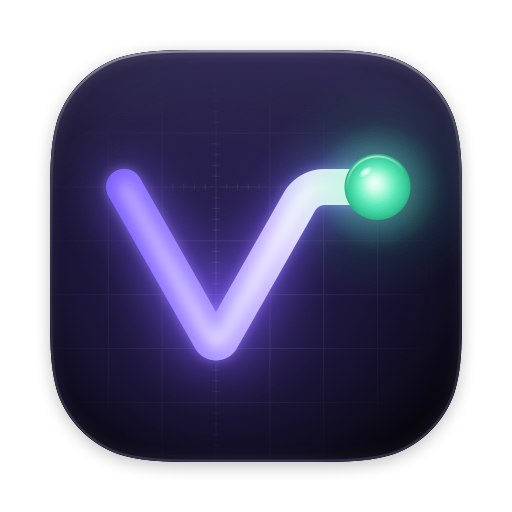
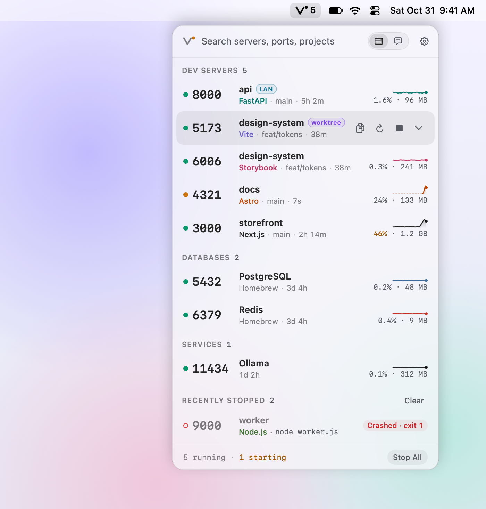
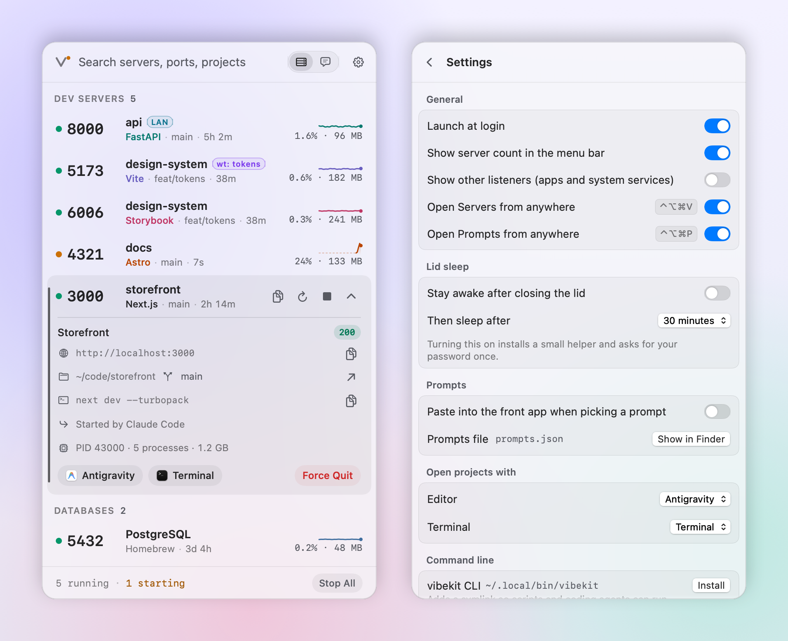
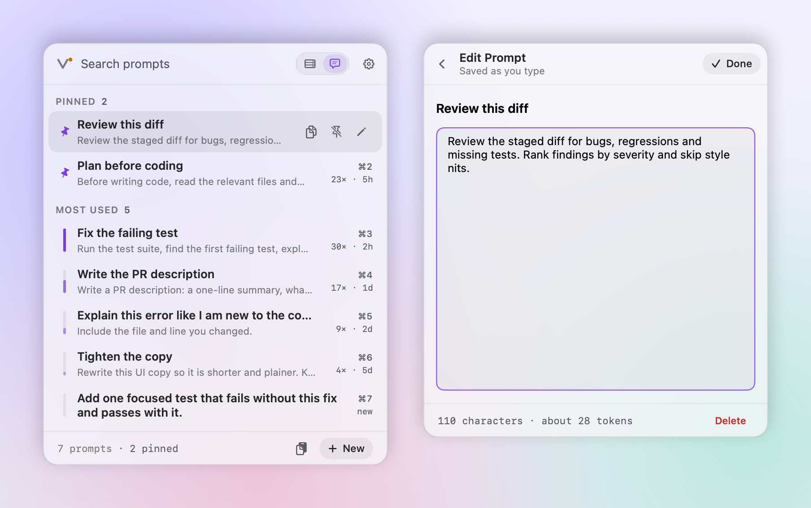

<p align="center">
  
</p>

<h1 align="center">Vibe Kit</h1>

<p align="center">
  Every dev server on your Mac, one click away in the menu bar.<br>
  See what is running, on which port, from which project, and how it is doing. Then open, restart or stop it.
</p>

<p align="center">
  <a href="https://github.com/aryarashid/vibekit/releases/latest"></a>
  
  
  <a href="https://github.com/aryarashid/vibekit/actions/workflows/ci.yml"></a>
  <a href="LICENSE"></a>
</p>

<p align="center">
  <picture>
    <source media="(prefers-color-scheme: dark)" srcset="docs/images/hero-dark.png">
    
  </picture>
</p>

## Why

You start a Vite server in one terminal tab, a Next.js app in another, an API in a third, and Postgres has been running since Tuesday. A day later you have no idea what is on port 3000, which branch it is serving, or why your laptop fan is on.

Click the **V** in the menu bar, or press **⌃⌥⌘V** from anywhere. Vibe Kit lists every server that is listening, grouped and named by project, with its framework, branch, uptime and a live CPU trace. It runs as a tiny native app and costs about 0.2% of one CPU core while you are not looking at it.

## What the lights mean

Each row starts with a status light. Every look carries one fact, so a glance down the column tells you what needs attention. Hover a port to read its light in words.

| Light | Meaning |
| --- | --- |
| Steady green | Up and answering. |
| Green with a ripple | Busy right now, using 10% CPU or more, such as compiling or reloading. |
| One green flash | Just became ready. Reload your browser. |
| Amber, breathing | Listening, but has not answered its first request yet. |
| Steady amber | Listening, but not answering HTTP. |
| Red | Answering with server errors (5xx). |
| Hollow grey ring | Stopped. Start it again with one click. |
| Hollow red ring | Crashed, with its exit code. Right-click to open its log. |

The **V** in the panel header shows the worst light across all dev servers, and the footer counts what is failing or still starting. The CPU figure turns amber above 30% and red above 80%. In dark mode the lights and traces glow a little, because neon reads as light there. With Reduce Motion turned on, the lights stay still.

## What it does

<p align="center">
  <picture>
    <source media="(prefers-color-scheme: dark)" srcset="docs/images/details-dark.png">
    
  </picture>
</p>

- **Finds servers by port.** Vite, Next.js, Astro, Django, FastAPI, Rails, Phoenix, Go, Rust, Swift, local AI servers (Ollama, llama.cpp, vLLM, MLX-LM, LiteLLM), workflow engines (Inngest, Temporal), and about 100 other frameworks, databases and services are recognised. Anything else that listens on a port is still listed, under Other Listeners.
- **Unpacks Docker and OrbStack containers.** Published ports from Docker or OrbStack containers show up as the database or service running inside each container (such as PostgreSQL or Redis with its container name), asked directly over the local Docker Unix socket while the panel is open.
- **Names them by project and launcher.** Each server shows its git repository, subfolder and branch. Linked worktrees get the main repository's name and a worktree tag (showing the worktree slug when several checkouts of the same repo are running). Expanded details show which app or coding agent started the server (such as Claude Code, Ghostty or launchd).
- **Groups them.** Dev servers first, then databases (Postgres, Redis, MySQL, MongoDB and more), then services (Docker, OrbStack, Ollama, Mailpit, MinIO, ngrok, Cloudflare Tunnel and more). Web UI ports come first for multi-port tools like Mailpit, MinIO and RabbitMQ, and every listening port is clickable in details.
- **Acts in one click or one key.** Open in the browser (including HTTP services and admin UIs). Copy the URL, or the connection URL for a database. Re-check HTTP status or skip checks for non-HTTP dev servers. Restart. Stop, or force quit. Stop all dev servers. Open the folder in your editor or terminal, or reveal it in Finder.
- **Restarts properly.** Vibe Kit walks up from the listening process to the command you actually typed (`npm run dev`, `uv run`, `cargo run`, `node --watch` and so on), then starts it again in the same folder with the same environment. Restarted servers write to a log you can read live in the panel, with colors.
- **Notices crashes.** A server Vibe Kit started that exits with an error stays in the list as crashed, with its exit code and a clickable crash badge that jumps straight to its log. Crashes that happen while the panel is closed surface as a notice the next time you open it.
- **Warns about shared ports.** When two servers hold the same port (for example IPv4 and IPv6), each row labels its address family (`shared · IPv4` / `shared · IPv6`), opens directly to `127.0.0.1` or `[::1]`, and offers **Stop Other** in the right-click menu.
- **Shares to your phone.** Servers bound to all interfaces get a **LAN** tag, a network URL and a QR code.
- **Answers port questions.** Type a port number to see if it is free, or copy a `sudo lsof` command when another user or system service owns it. Type a PID, branch, launcher or container name to filter straight to it.
- **Works with any menu bar.** The panel opens in the right place when the menu bar hides itself, on the display you are using, and when the icon is hidden behind the notch.

## Prompts

<p align="center">
  <picture>
    <source media="(prefers-color-scheme: dark)" srcset="docs/images/prompts-dark.png">
    
  </picture>
</p>

The panel's second tab keeps the prompts you send to coding agents again and again. Press **Tab** in the panel to switch to it, or **⌃⌥⌘P** from anywhere.

- **Use one in a keystroke.** Press ↩, or ⌘1 to ⌘9, to copy a prompt. Turn on **Paste into the app in front** in Settings and Vibe Kit pastes it for you when the panel closes, then puts your previous clipboard back. Pasting needs Accessibility access, which macOS asks for the first time.
- **Context variables.** Prompts can include `{{url}}`, `{{port}}`, `{{branch}}`, `{{project}}` and `{{clipboard}}`. Vibe Kit fills them from your active dev server (preferring a failing one) and your clipboard right when you use the prompt.
- **Your best ones float up.** Pin the ones you always want on top. The rest are ordered by how often and how recently you used them, and the bar on the left of each row shows it.
- **Save from anywhere.** Select text in any app, then right-click and choose **Services → Add to Vibe Kit**. Or press **New**, or save what is on the clipboard.
- **A file you own.** Prompts live in `~/Library/Application Support/VibeKit/prompts.json`, readable and sorted, so you can edit it by hand or keep it in your dotfiles. Changes made outside Vibe Kit show up the next time the panel opens.

## Stay awake with the lid closed

Agents and builds stop when a MacBook sleeps, and it sleeps the moment the lid closes. Turn on **Stay awake after closing the lid** in Settings and pick how long: 15, 30 or 45 minutes, or an hour. The screen goes dark as usual, work keeps running, and the Mac goes to sleep when the time is up.

- **Safe in a bag.** At 15% battery or less it sleeps at once. A wake later with the lid still closed does not start the timer again.
- **Docked stays docked.** With an external display, the Mac works with the lid closed as before, and the timer never sends it to sleep.
- **Back online on the move.** With the lid closed, macOS does not look for your iPhone's Personal Hotspot when Wi-Fi drops, so walking from one café to the next leaves the Mac offline. When **Reconnect to my iPhone's hotspot** is on (it is by default), Vibe Kit waits 20 seconds for macOS to rejoin a network it knows. If none comes back, it turns on your own iPhone's hotspot and joins it. It only asks phones signed in to your Apple Account, never a Family Sharing member's, which would put a prompt on their screen. If the phone is out of reach it tries again after 1, 2 and 4 minutes, then every 5. It does nothing with the lid open, with Wi-Fi switched off, or with Ethernet connected. There is no public macOS API for this, so it uses the same private interface as the Wi-Fi menu. If a macOS update changes that interface, the feature stops working, but nothing crashes.
- **One password, once.** The first time you turn it on, Vibe Kit installs a small helper and asks for an administrator password. macOS only lets an administrator stop lid sleep. After that, switching it off and on or changing the time needs no password.
- **How it works.** The helper is a small native program that runs as a LaunchDaemon (`/Library/LaunchDaemons/dev.vibekit.lid-sleep.plist`). It does not poll: macOS tells it when the lid, the power source or the setting changes, so a change in Settings applies at once. While the lid is open it sets `pmset disablesleep`, which has to be set before the lid closes. When the lid closes it turns the display off (`pmset displaysleepnow`), so only the system stays awake, counts down, then clears the setting and puts the Mac to sleep. With the lid open, the Mac still goes to sleep by itself as usual: once you have been away longer than the sleep timer in Battery settings and nothing else is keeping it awake, the helper lets go of the setting, and asks for sleep a minute later if macOS has not slept by then. On battery at 15% or less it lets go at once. If the helper stops for any reason, it clears the setting first, so it never leaves the Mac unable to sleep. It also goes idle if Vibe Kit is moved to the Trash. It keeps its timer across restarts and updates, so one with the lid closed carries on counting. It writes what it is doing to `/var/run/dev.vibekit.lid-sleep.status`.

To remove the helper, switch the setting off and press **Remove**. From a terminal, run `sudo launchctl bootout system/dev.vibekit.lid-sleep`, then delete `/Library/LaunchDaemons/dev.vibekit.lid-sleep.plist`, `/Library/PrivilegedHelperTools/dev.vibekit.lid-sleep` and `/Library/Application Support/Vibe Kit`, then run `sudo pmset -a disablesleep 0`.

To check it after a lid close, run `pmset -g log | grep -iE 'clamshell|sleep'` and compare the time the lid closed with the time the Mac slept.

## Install

### Download

1. Download `Vibe-Kit.dmg` from the [latest release](https://github.com/aryarashid/vibekit/releases/latest) and open it.
2. Drag **Vibe Kit** onto **Applications**.
3. Open it from Applications. Look for the **V** in the menu bar.

The app is signed with a Developer ID and notarized by Apple, so it opens without a warning. It runs on Apple silicon and Intel, on macOS 14 or later.

Releases after 1.3.0 keep themselves up to date: Vibe Kit checks GitHub once a day, downloads an update in the background and installs it when the app next quits or restarts. Change that under Settings › Updates, or pick **Check for Updates…** from the menu bar icon's right-click menu. Copies of 1.3.0 or older need one manual download.

### Build from source

You need macOS 14 or later and Swift 6 (Xcode 16 or later, or the Command Line Tools).

```sh
git clone https://github.com/aryarashid/vibekit.git
cd vibekit
./scripts/install.sh
```

The script builds a release binary, wraps it in `Vibe Kit.app`, signs it ad hoc, copies it to `/Applications` (or `~/Applications`) and starts it. To build without installing, run `./scripts/build-app.sh`. Set `UNIVERSAL=1` for a binary that runs on Apple silicon and Intel.

Releases are built by the Release workflow when the `VERSION` file is bumped on main. To build a signed and notarized release on your Mac instead, run `./scripts/release.sh`. Both are described in [docs/RELEASING.md](docs/RELEASING.md).

The first time it runs from Applications, Vibe Kit turns on Launch at Login. Turn it off in Settings, or from the menu bar icon's right-click menu.

To uninstall, quit Vibe Kit and delete the app. It keeps a little state and your prompts in `~/Library/Application Support/VibeKit` and the logs of servers it started in `~/Library/Logs/VibeKit`.

## Keyboard

| Key | Action |
| --- | --- |
| ⌃⌥⌘V | Open or close the panel from anywhere |
| ⌃⌥⌘P | Open the Prompts tab from anywhere |
| Tab | Switch between Servers and Prompts |
| Type | Filter by port, project, framework, branch, command or PID |
| ↑ ↓ | Move between servers |
| ↩ | Open in the browser, or start a stopped server |
| ⌘1 to ⌘9 | Open the first nine servers |
| → | Show details |
| ⌘R | Restart |
| ⌘⌫ | Stop |
| ⇧⌘C | Copy URL |
| ⌘O, ⌘T | Open in editor, open in terminal |
| ⌘, | Settings |
| Esc | Clear the filter, then close |

In the Prompts tab, ↩ and ⌘1 to ⌘9 use a prompt, ⌘N makes a new one, ⌘E edits, ⌘P pins, ⇧⌘C copies without closing and ⌘⌫ deletes.

Right-click any server or prompt for every action in one menu. Right-click the menu bar icon for Launch at Login, the logs folder and Quit.

## Light on your Mac

Vibe Kit is written in Swift and asks the kernel directly through `libproc`. It does not run `lsof`, `ps` or `git`, and has no browser engine or background web view.

- While the panel is closed it scans every 4 seconds, with timer leeway so macOS can batch wakeups. Each scan checks new processes and known listeners, with a full sweep every 30 seconds.
- While the panel is open it scans every 1.5 seconds, so the traces stay live.
- The panel's live views are built when it opens and released when it closes. An empty hosting view is reused to avoid repeatedly setting up AppKit and SwiftUI. Vibe Kit warms it invisibly after launch, so the first real open is quick. Opening and closing have no animation delay.
- The status lights animate with Core Animation, which the window server runs on its own. Vibe Kit does no work per frame.
- Each dev server gets one `GET /` to read its page title and status, not a poll, because frameworks like Next.js compile on every request. If a server does not answer yet, Vibe Kit tries again a few times while the panel is open.

Measured on an M1 Pro MacBook Pro running about 1,100 processes:

| | CPU | Memory |
| --- | --- | --- |
| Panel closed | about 0.2% of one core | about 17 MB resident |
| Panel open | about 2% of one core | about 40 MB resident |

Measure it on your own machine:

```sh
"/Applications/Vibe Kit.app/Contents/MacOS/VibeKit" --bench 40          # panel closed
"/Applications/Vibe Kit.app/Contents/MacOS/VibeKit" --bench 40 --open   # panel open
```

## Privacy

Everything Vibe Kit shows comes from your own machine. It makes two kinds of network request. It asks your own local dev servers for their page titles. Once a day it fetches the update feed (`appcast.xml`) from GitHub, and downloads the update if there is one. The update check sends no system profile, analytics or identifiers, only what any download sends: your IP address and the app's version in the user agent. Turn the checks off under Settings › Updates. Builds from source never check. To restart a server, Vibe Kit reads that process's environment variables and keeps them in memory only. They are never written to disk, logged or shown.

## Command line & MCP

Install the `vibekit` symlink from **Settings › Command line** (links `~/.local/bin/vibekit` or `/usr/local/bin/vibekit`), or invoke the app binary directly:

```sh
vibekit --list [--all] [--cpu] [--json]       # servers as a table or JSON (--cpu samples 300 ms)
vibekit port <N> [--json]                     # check port availability and owner (exit 0 free, 1 taken)
vibekit port --next <N> [--json]              # find the next free port starting at N
vibekit stop <target> [--json]                # stop by port, PID, or project/title
vibekit restart <target> [--json]             # restart and capture logs
vibekit logs <target> [--tail N]              # print the last N clean log lines (default 50)
vibekit prompt [query] [--json]               # list prompts, or expand and print the best match
vibekit --toggle [servers|prompts] [--query]  # open or filter the running panel (Raycast, Alfred, scripts)
vibekit --mcp [--allow-control]               # stdio MCP server for coding agents
vibekit --bench [sec] [--open]                # measure scan cost
vibekit --snapshot out.png [options]          # render the panel to a PNG without opening it
```

With `--mcp`, coding agents (Claude Code, Codex, Cursor and others) can call `list_servers`, `check_port`, `probe_server`, `read_server_logs` and `list_prompts` over stdio. Pass `--allow-control` to also expose `stop_server` and `restart_server`.

`--demo` renders sample servers and prompts instead of yours, which is how the screenshots above are made.

## Development

```sh
swift build                    # debug build
swift test                     # core tests plus native panel layout, focus and lifecycle tests
swift run VibeKit              # run from the terminal
./scripts/screenshots.sh       # render the README images from demo data
swift scripts/make-icon.swift build   # redraw the app icon (copy build/icon-512.png to assets/icon.png)
```

`VibeKitCore` holds the scanner, classifier and process control, with no UI. `VibeKit` is the AppKit and SwiftUI app. The design brief is in [`docs/design/BRIEF.md`](docs/design/BRIEF.md).

Issues and pull requests are welcome. If Vibe Kit does not recognise your framework, open an issue with the output of `VibeKit --list --all` for that server.

## License

MIT. See [LICENSE](LICENSE).
