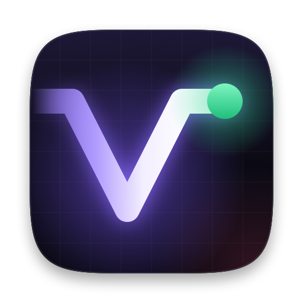
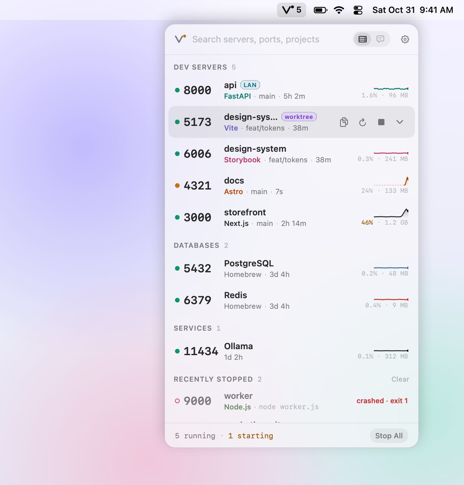
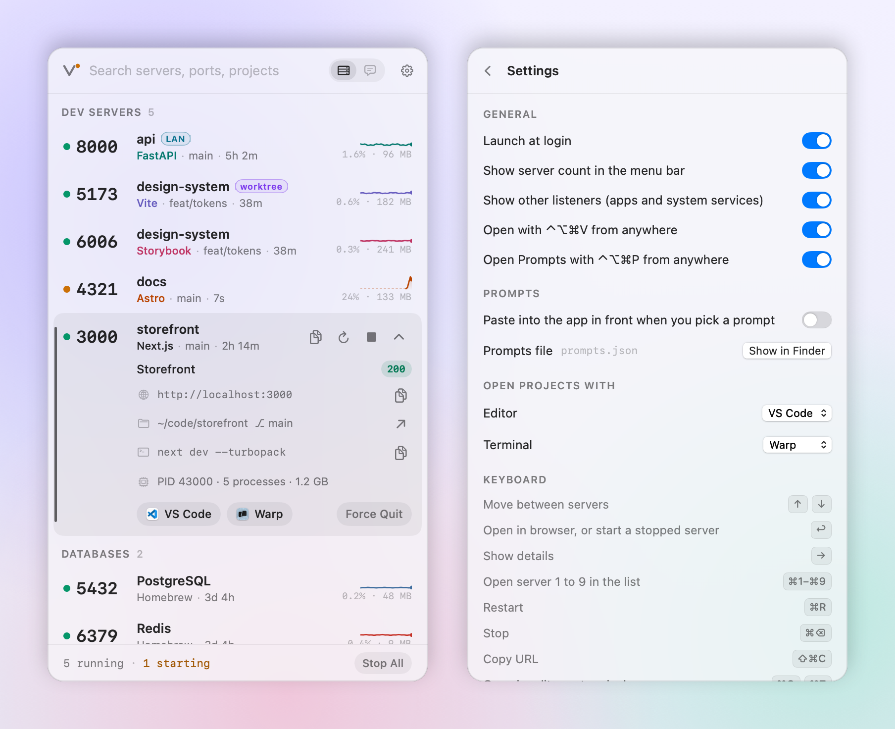
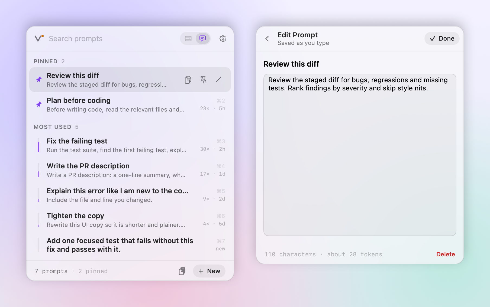

<p align="center">
  
</p>

<h1 align="center">Vibe Kit</h1>

<p align="center">
  Every dev server on your Mac, one click away in the menu bar.<br>
  See what is running, on which port, from which project, and how it is doing. Then open, restart or stop it.
</p>

<p align="center">
  <a href="https://github.com/aryarashid/vibekit/releases/latest"></a>
  
  
  <a href="https://github.com/aryarashid/vibekit/actions/workflows/ci.yml"></a>
  <a href="LICENSE"></a>
</p>

<p align="center">
  <picture>
    <source media="(prefers-color-scheme: dark)" srcset="docs/images/hero-dark.png">
    
  </picture>
</p>

## Why

You start a Vite server in one terminal tab, a Next.js app in another, an API in a third, and Postgres has been running since Tuesday. A day later you have no idea what is on port 3000, which branch it is serving, or why your laptop fan is on.

Click the **V** in the menu bar, or press **⌃⌥⌘V** from anywhere. Vibe Kit lists every server that is listening, grouped and named by project, with its framework, branch, uptime and a live CPU trace. It runs as a tiny native app and costs about 0.2% of one CPU core while you are not looking at it.

## What the lights mean

Each row starts with a status light. Every look carries one fact, so a glance down the column tells you what needs attention. Hover a port to read its light in words.

| Light | Meaning |
| --- | --- |
| Steady green | Up and answering. |
| Green with a ripple | Busy right now, using 10% CPU or more, such as compiling or reloading. |
| One green flash | Just became ready. Reload your browser. |
| Amber, breathing | Listening, but has not answered its first request yet. |
| Steady amber | Listening, but not answering HTTP. |
| Red | Answering with server errors (5xx). |
| Hollow grey ring | Stopped. Start it again with one click. |
| Hollow red ring | Crashed, with its exit code. Right-click to open its log. |

The **V** in the panel header shows the worst light across all dev servers, and the footer counts what is failing or still starting. The CPU figure turns amber above 30% and red above 80%. In dark mode the lights and traces glow a little, because neon reads as light there. With Reduce Motion turned on, the lights stay still.

## What it does

<p align="center">
  <picture>
    <source media="(prefers-color-scheme: dark)" srcset="docs/images/details-dark.png">
    
  </picture>
</p>

- **Finds servers by port.** Vite, Next.js, Astro, Django, FastAPI, Rails, Phoenix, Go, Rust, Swift and about 90 other frameworks, databases and services are recognised. Anything else that listens on a port is still listed, under Other Listeners.
- **Names them by project.** Each server shows its git repository, subfolder and branch. Linked worktrees get the main repository's name and a **worktree** tag.
- **Groups them.** Dev servers first, then databases (Postgres, Redis, MySQL, MongoDB and more), then services (Docker, OrbStack, Ollama, ngrok, Cloudflare Tunnel and more). Desktop apps and system processes stay out of the way in a collapsed section.
- **Acts in one click or one key.** Open in the browser. Copy the URL, or the connection URL for a database. Restart. Stop, or force quit. Stop all dev servers. Open the folder in your editor or terminal, or reveal it in Finder.
- **Restarts properly.** Vibe Kit walks up from the listening process to the command you actually typed (`npm run dev`, `uv run`, `cargo run` and so on), then starts it again in the same folder with the same environment. Restarted servers write to a log you can read live in the panel, with colors.
- **Notices crashes.** A server Vibe Kit started that exits with an error stays in the list as crashed, with its exit code and its log. One you stopped yourself just shows as stopped.
- **Warns about shared ports.** When two servers hold the same port, for example one on IPv4 and one on IPv6, both get a **shared port** tag, because `localhost` may reach either one.
- **Shares to your phone.** Servers bound to all interfaces get a **LAN** tag, a network URL and a QR code.
- **Answers port questions.** Type a port number to see if it is free. Type a PID to find its server.
- **Works with any menu bar.** The panel opens in the right place when the menu bar hides itself, on the display you are using, and when the icon is hidden behind the notch.

## Prompts

<p align="center">
  <picture>
    <source media="(prefers-color-scheme: dark)" srcset="docs/images/prompts-dark.png">
    
  </picture>
</p>

The panel's second tab keeps the prompts you send to coding agents again and again. Press **Tab** in the panel to switch to it, or **⌃⌥⌘P** from anywhere.

- **Use one in a keystroke.** Press ↩, or ⌘1 to ⌘9, to copy a prompt. Turn on **Paste into the app in front** in Settings and Vibe Kit pastes it for you when the panel closes. Pasting needs Accessibility access, which macOS asks for the first time.
- **Your best ones float up.** Pin the ones you always want on top. The rest are ordered by how often and how recently you used them, and the bar on the left of each row shows it.
- **Save from anywhere.** Select text in any app, then right-click and choose **Services → Add to Vibe Kit**. Or press **New**, or save what is on the clipboard.
- **A file you own.** Prompts live in `~/Library/Application Support/VibeKit/prompts.json`, readable and sorted, so you can edit it by hand or keep it in your dotfiles. Changes made outside Vibe Kit show up the next time the panel opens.

## Install

### Download

1. Download `Vibe-Kit.zip` from the [latest release](https://github.com/aryarashid/vibekit/releases/latest) and unzip it.
2. Move **Vibe Kit** to your Applications folder and open it.
3. The build is not notarized, so the first time macOS will say it cannot check the app. Open **System Settings → Privacy & Security**, scroll down and click **Open Anyway**. Or run this once:

   ```sh
   xattr -dr com.apple.quarantine "/Applications/Vibe Kit.app"
   ```

### Build from source

You need macOS 14 or later and Swift 6 (Xcode 16 or later, or the Command Line Tools).

```sh
git clone https://github.com/aryarashid/vibekit.git
cd vibekit
./scripts/install.sh
```

The script builds a release binary, wraps it in `Vibe Kit.app`, signs it ad hoc, copies it to `/Applications` (or `~/Applications`) and starts it. To build without installing, run `./scripts/build-app.sh`. Set `UNIVERSAL=1` for a binary that runs on Apple silicon and Intel.

On first run Vibe Kit turns on Launch at Login. Turn it off in Settings, or from the menu bar icon's right-click menu.

To uninstall, quit Vibe Kit and delete the app. It keeps a little state and your prompts in `~/Library/Application Support/VibeKit` and the logs of servers it started in `~/Library/Logs/VibeKit`.

## Keyboard

| Key | Action |
| --- | --- |
| ⌃⌥⌘V | Open or close the panel from anywhere |
| ⌃⌥⌘P | Open the Prompts tab from anywhere |
| Tab | Switch between Servers and Prompts |
| Type | Filter by port, project, framework, branch, command or PID |
| ↑ ↓ | Move between servers |
| ↩ | Open in the browser, or start a stopped server |
| ⌘1 to ⌘9 | Open the first nine servers |
| → | Show details |
| ⌘R | Restart |
| ⌘⌫ | Stop |
| ⇧⌘C | Copy URL |
| ⌘O, ⌘T | Open in editor, open in terminal |
| ⌘, | Settings |
| Esc | Clear the filter, then close |

In the Prompts tab, ↩ and ⌘1 to ⌘9 use a prompt, ⌘N makes a new one, ⌘E edits, ⌘P pins, ⇧⌘C copies without closing and ⌘⌫ deletes.

Right-click any server or prompt for every action in one menu. Right-click the menu bar icon for Launch at Login, the logs folder and Quit.

## Light on your Mac

Vibe Kit is written in Swift and asks the kernel directly through `libproc`. It does not run `lsof`, `ps` or `git`, and it keeps no window or web view alive in the background.

- While the panel is closed it scans every 4 seconds, with timer leeway so macOS can batch wakeups. Each scan checks new processes and known listeners, with a full sweep every 30 seconds.
- While the panel is open it scans every 1.5 seconds, so the traces stay live.
- The panel's views are built when it opens and thrown away when it closes. A few seconds after launch Vibe Kit opens the panel once, invisible and off screen, so the first real open is quick.
- The status lights animate with Core Animation, which the window server runs on its own. Vibe Kit does no work per frame.
- Each dev server gets one `GET /` to read its page title and status, not a poll, because frameworks like Next.js compile on every request. If a server does not answer yet, Vibe Kit tries again a few times while the panel is open.

Measured on an M1 Pro MacBook Pro running about 1,100 processes:

| | CPU | Memory |
| --- | --- | --- |
| Panel closed | about 0.2% of one core | about 17 MB resident |
| Panel open | about 2% of one core | about 40 MB resident |

Measure it on your own machine:

```sh
"/Applications/Vibe Kit.app/Contents/MacOS/VibeKit" --bench 40          # panel closed
"/Applications/Vibe Kit.app/Contents/MacOS/VibeKit" --bench 40 --open   # panel open
```

## Privacy

Everything Vibe Kit shows comes from your own machine. Its only network requests go to your own local dev servers, to read each one's page title. To restart a server, Vibe Kit reads that process's environment variables and keeps them in memory only. They are never written to disk, logged or shown.

## Command line

The app binary doubles as a small CLI:

```sh
VibeKit --list               # dev servers, databases and services as a table
VibeKit --list --all         # include apps and other listeners
VibeKit --toggle             # open or close the panel of the running app, for Raycast, Alfred or scripts
VibeKit --toggle prompts     # the same, on the Prompts tab
VibeKit --bench [sec]        # measure scan cost; add --open for the open-panel cadence
VibeKit --snapshot out.png   # render the panel to a PNG without opening it
        [--dark] [--settings] [--prompts] [--edit-prompt] [--query text] [--select-port N] [--expand-port N]
        [--demo] [--transparent]
```

`--demo` renders sample servers and prompts instead of yours, which is how the screenshots above are made.

## Development

```sh
swift build                    # debug build
swift test                     # classifier, parser, project, exit code and prompt tests
swift run VibeKit              # run from the terminal
./scripts/screenshots.sh       # render the README images from demo data
swift scripts/make-icon.swift build   # redraw the app icon (copy build/icon-512.png to assets/icon.png)
```

`VibeKitCore` holds the scanner, classifier and process control, with no UI. `VibeKit` is the AppKit and SwiftUI app. The design brief is in [`docs/design/BRIEF.md`](docs/design/BRIEF.md).

Issues and pull requests are welcome. If Vibe Kit does not recognise your framework, open an issue with the output of `VibeKit --list --all` for that server.

## License

MIT. See [LICENSE](LICENSE).
